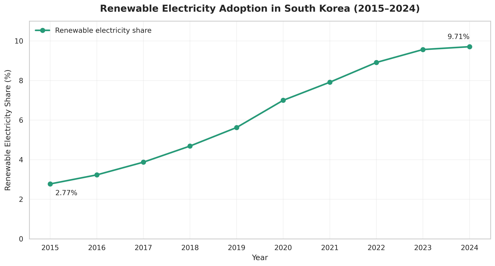
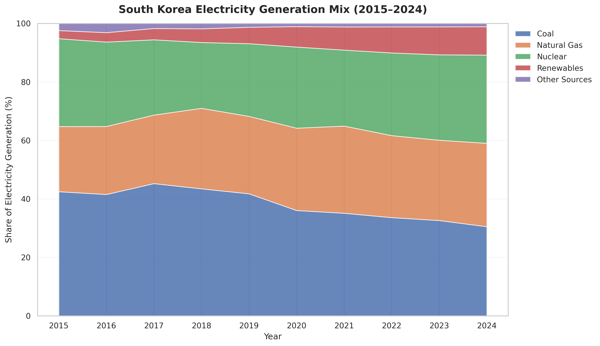
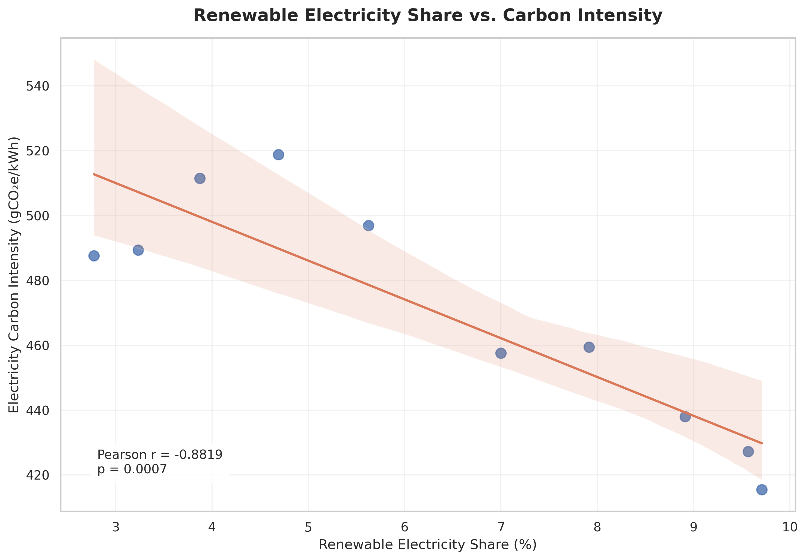
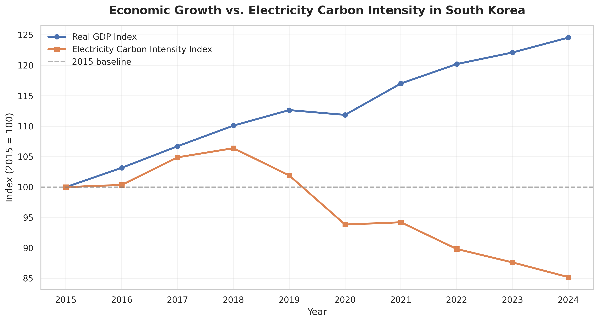
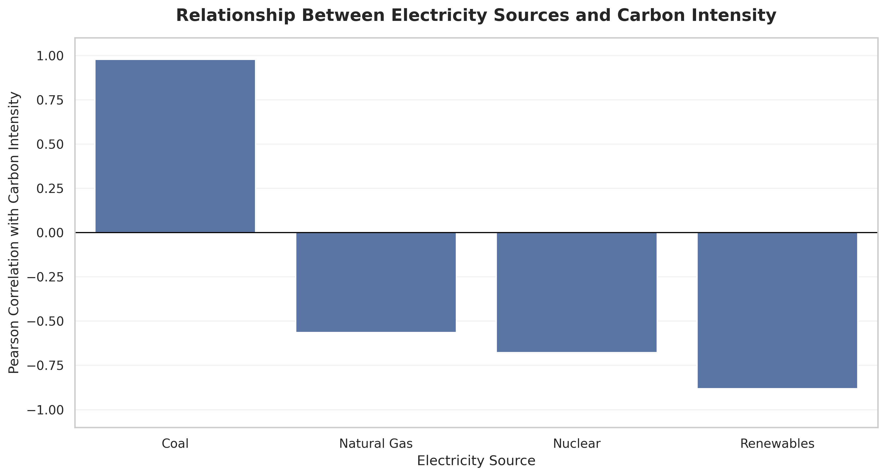

# South Korea Renewable Energy & Economic Analysis (2015–2024)

## Overview

This project examines the relationship between renewable electricity adoption, electricity generation patterns, carbon intensity, and economic growth in South Korea from 2015 to 2024.

Using Python, publicly available economic and energy datasets, and statistical analysis, the project investigates how South Korea's changing electricity mix coincided with environmental and economic trends.

## Research Question

To what extent has renewable energy adoption in South Korea been associated with changes in electricity generation, carbon intensity, and economic growth?

## Key Findings

- **Renewable electricity adoption increased:** Renewable electricity's share of generation rose from 2.77% in 2015 to 9.71% in 2024.
- **Coal's share declined:** Coal fell from 42.48% to 30.51% of electricity generation.
- **Electricity carbon intensity decreased:** Carbon intensity declined by 14.79% over the study period.
- **Economic growth continued:** Real GDP increased by 24.56% between 2015 and 2024.
- **Renewables and carbon intensity were strongly negatively correlated:** Pearson's *r* = −0.8819 (*p* = 0.0007; *n* = 10).
- **GDP growth and renewable adoption:** The observed correlation was not statistically significant at the 5% level.

These findings describe associations, not proof of causation.

## Visualizations

The five figures below are stored in the repository's root directory.

### 1. Renewable Electricity Adoption

### 2. Electricity Generation Mix

### 3. Renewable Electricity vs. Carbon Intensity

### 4. Economic Growth vs. Carbon Intensity

### 5. Electricity Sources vs. Carbon Intensity

## Data Sources & References

### Economic data

- **World Bank, World Development Indicators (WDI):** GDP (constant 2015 US$), indicator `NY.GDP.MKTP.KD`, and GDP growth (annual %), indicator `NY.GDP.MKTP.KD.ZG`, for Korea, Rep.
- [World Bank GDP series — Korea, Rep.](https://data.worldbank.org/indicator/NY.GDP.MKTP.KD?locations=KR)
- [GDP indicator definition](https://databank.worldbank.org/metadataglossary/world-development-indicators/series/NY.GDP.MKTP.KD)

### Electricity data

- **Our World in Data (OWID), Energy dataset:** the report identifies OWID's energy and electricity dataset as the source for renewable electricity share, electricity generation mix, and electricity carbon intensity.
- OWID documents Ember's Yearly Electricity Data among the underlying sources used to compile its electricity-mix data. Ember is therefore acknowledged as an underlying data provider, not represented here as a separately verified direct download for this project.
- [OWID Energy dataset and source documentation](https://github.com/owid/energy-data)
- [Ember — Yearly Electricity Data](https://ember-energy.org/data/yearly-electricity-data/)

### Data preparation and attribution

The analysis combines ten annual observations for South Korea (2015–2024). The cleaned CSV contains GDP, GDP growth, renewable electricity share, electricity carbon intensity, and electricity generation shares for coal, natural gas, nuclear, and other sources.

The original download date and version-specific snapshot of the OWID dataset are not recorded in the materials currently available for this project. Add those details if they can be recovered from the original data-collection notebook. Consult the providers' documentation for indicator definitions, source attribution, licensing, and revisions.

This is an independent undergraduate analysis and is not affiliated with or endorsed by the World Bank, Our World in Data, or Ember.

## Methodology

The analysis uses annual observations from 2015 through 2024 and includes:

- Data collection and integration
- Data cleaning and validation
- Exploratory data analysis
- Pearson and Spearman correlation analysis
- Sensitivity analysis excluding 2020
- Trend analysis and data visualization

## Tools & Technologies

- Python
- Pandas and NumPy
- Matplotlib and Seaborn
- SciPy
- Google Colab
- GitHub

## Repository Contents

- **Python notebook:** [`notebooks/South_Korea_Renewable_Energy_Analysis.ipynb`](notebooks/South_Korea_Renewable_Energy_Analysis.ipynb)
- **Cleaned dataset:** [`data/South_Korea_Renewable_Energy_Data.csv`](data/South_Korea_Renewable_Energy_Data.csv)
- **Research report:** [`1. report/South_Korea_Renewable_Energy_Research_Report.pdf`](1.%20report/South_Korea_Renewable_Energy_Research_Report.pdf)
- **Visualizations:** Five PNG figures in the repository's root directory
- **Figure archive:** `South_Korea_Research_Figures.zip`

## Limitations

This study uses a relatively small annual sample of ten observations. Correlation does not establish causation, and electricity generation shares are interdependent. The analysis focuses on electricity-sector carbon intensity rather than the entire economy's emissions.

## Future Research

Future work could incorporate additional years of data, energy prices, electricity demand, policy changes, investment trends, and more advanced statistical methods to better understand the economic and environmental dimensions of South Korea's energy transition.

## Research Period

2015–2024

## Author

Cayden Miller  
University of Florida
